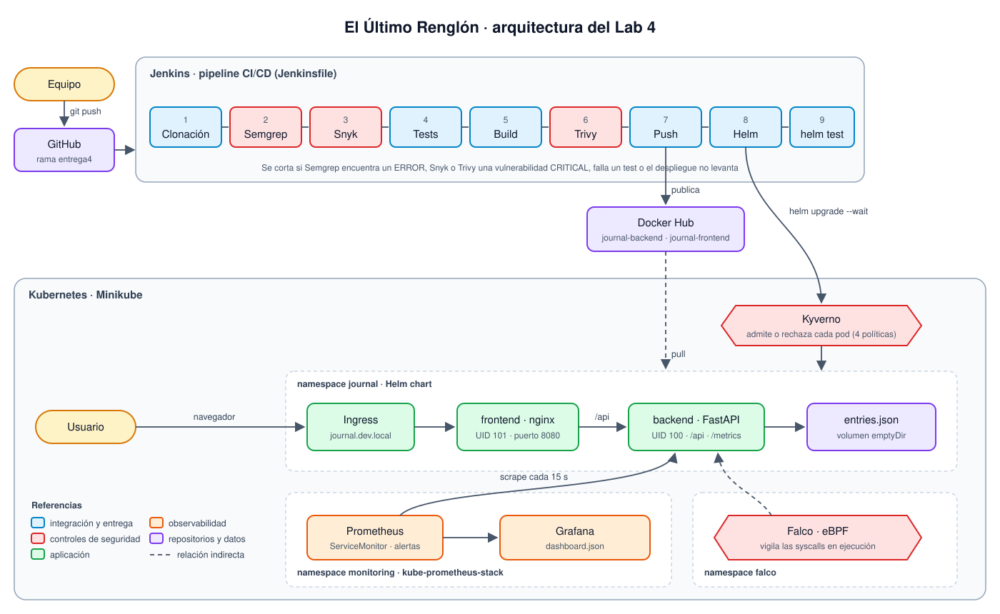
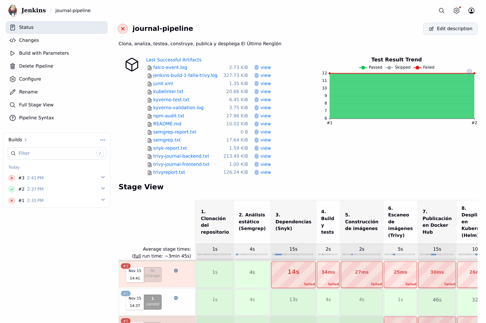
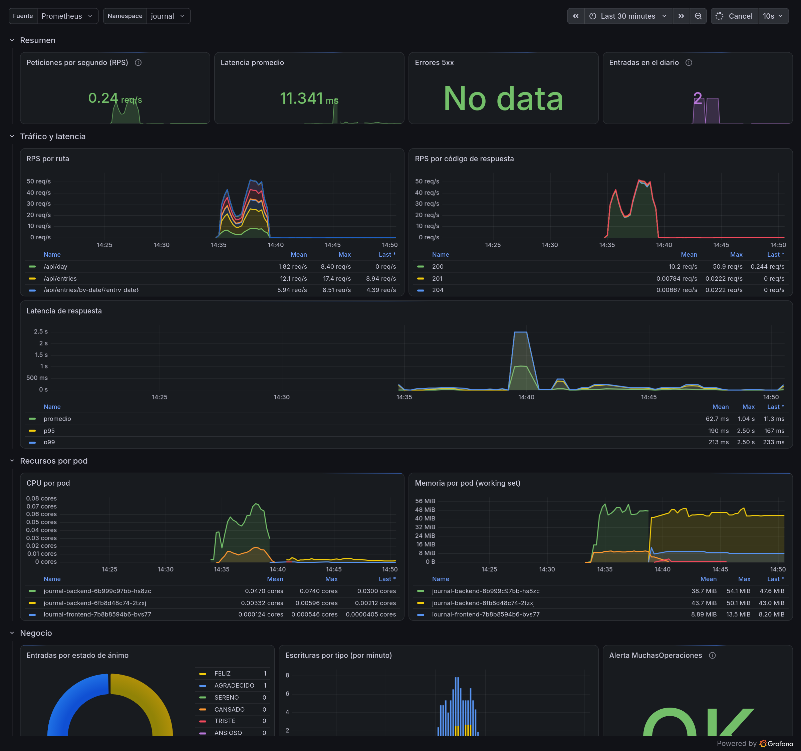

# Somos Los Bandidos©

## El Último Renglón · Laboratorio 4, trabajo integrador

Este repositorio es el trabajo integrador de DevOps. Partimos de una aplicación que fuimos construyendo durante el curso y le sumamos todo lo necesario para que se construya, se analice, se publique, se despliegue y se monitoree sola: contenedores, Helm, Jenkins, Prometheus, Grafana, Semgrep, Snyk, Trivy, Kyverno y Falco.

El paso a paso con todos los comandos y lo que devuelve cada uno está en [`docs/paso-a-paso.md`](docs/paso-a-paso.md). Este documento es el informe: explica qué hicimos, por qué y qué resultados obtuvimos.

---

## 1. Descripción general

"El Último Renglón" es un diario personal. Cada día se escribe una entrada con un texto libre y un estado de ánimo (sereno, feliz, cansado...). Solo se puede escribir o editar la entrada del día; las anteriores quedan de solo lectura, y la fecha la decide el servidor para que nadie pueda escribir en el pasado cambiando el reloj de su computadora.

La aplicación tiene dos partes:

- **Backend**, una API en FastAPI (Python 3.13) que guarda las entradas en un archivo JSON y expone métricas para Prometheus en `/metrics/`.
- **Frontend**, una página HTML con JavaScript servida por nginx, que además reenvía al backend todo lo que empieza con `/api/`.

La app es chica a propósito. Lo que nos interesaba era todo lo que la rodea, así que la dejamos simple para poder concentrarnos en la parte de DevOps.

Con respecto al Lab 3, los cambios principales fueron separar el frontend en su propio contenedor, empaquetar el despliegue en un Helm chart, montar Jenkins con un pipeline completo, instalar Prometheus y Grafana con un operador, sumar una cuarta política de Kyverno y migrarlas al formato nuevo, y escribir scripts que levantan y borran todo el entorno.

### Estructura del repositorio

| Carpeta o archivo | Qué contiene |
|---|---|
| `app/` | Código del backend (FastAPI) y sus métricas (`metrics.py`) |
| `frontend/` | `index.html`, `nginx.conf` y el Dockerfile del frontend |
| `Dockerfile` | Dockerfile multi-stage del backend (etapas `builder`, `test` y `runtime`) |
| `compose.yaml` | Frontend y backend juntos para desarrollo local |
| `helm-chart/` | Chart de la aplicación con `values.yaml`, `values-dev.yaml` y `values-prod.yaml` |
| `Jenkinsfile` | Pipeline de CI/CD |
| `jenkins/` | Imagen de Jenkins con las herramientas y su configuración como código |
| `k8s/policies/` | Las 4 políticas de Kyverno y los pods de prueba |
| `monitoring/values.yaml` | Configuración de kube-prometheus-stack |
| `grafana/dashboard.json` | Dashboard de Grafana exportado |
| `falco/values.yaml` | Instalación de Falco con nuestra regla propia |
| `semgrep/` | Reglas propias de Semgrep y un archivo de control con malas prácticas |
| `scripts/` | Scripts para levantar, probar y borrar todo |
| `reports/` | Resultados de todas las herramientas (los del Lab 3 quedaron en `reports/lab3/`) |
| `k8s/blue-green.yaml`, `k8s/monitoring.yaml` | Despliegue blue/green y monitoreo de los labs anteriores, que quedan como historia |

---

## 2. Arquitectura final



El diagrama se lee de arriba hacia abajo y sigue el camino de un cambio en el código.

Cuando alguien sube un cambio a GitHub, Jenkins clona el repositorio y lo hace pasar por nueve etapas. Las rojas son controles de seguridad que pueden frenar todo. Si el código, las dependencias y las imágenes están limpios y los tests pasan, Jenkins publica las dos imágenes en Docker Hub con una etiqueta única (`<número de build>-<commit>`) y le pide a Helm que actualice el despliegue.

Antes de que cualquier pod se cree en el cluster, Kubernetes le pregunta a Kyverno si cumple las cuatro políticas. Si no las cumple, se rechaza ahí mismo.

Dentro del namespace `journal` corre la aplicación. El usuario entra por el Ingress (o por un port-forward), llega al nginx del frontend, y las llamadas a `/api` siguen hacia el backend, que lee y escribe el JSON en un volumen `emptyDir`.

Al costado hay dos piezas que observan sin intervenir. Prometheus lee las métricas del backend cada 15 segundos (lo encuentra gracias a un `ServiceMonitor`) y Grafana las muestra en el dashboard. Falco mira las llamadas al sistema que hacen los contenedores y alerta si alguno hace algo raro.

### Decisiones de arquitectura

**Dos contenedores en lugar de uno.** Hasta el Lab 3 FastAPI también servía el HTML. Separarlo nos permite tener un Dockerfile por componente, como pide la letra, pero además tiene sentido técnico. nginx sirve archivos estáticos mucho mejor que Python, el frontend puede tener varias réplicas aunque el backend esté limitado a una, y cada parte se actualiza por separado. Como nginx hace de proxy para `/api`, el navegador ve un único origen y no tuvimos que habilitar CORS ni tocar el HTML.

**Una sola réplica del backend.** Cada pod guarda sus datos en su propio JSON, así que con dos réplicas cada una tendría datos distintos. Lo dejamos así porque migrar a una base de datos cambiaba la aplicación y no era el foco del trabajo, pero es la primera mejora que haríamos. Por la misma razón el backend se actualiza con la estrategia `Recreate` y no con `RollingUpdate`.

**Seguridad en todos los pods.** Todos corren con un usuario fijo distinto de root, la raíz del contenedor en solo lectura, sin capacidades del kernel, sin posibilidad de escalar privilegios, con el perfil seccomp por defecto y con límites de CPU y memoria. Como la raíz es de solo lectura, un initContainer copia los datos de ejemplo a un volumen escribible antes de arrancar la API.

### Contenedores

Cada componente tiene su Dockerfile multi-stage, con versiones fijas y usuario sin privilegios:

- **Backend** (`Dockerfile`). La etapa `builder` crea un entorno virtual con las dependencias. La etapa `test` le agrega pytest y los tests; el pipeline la usa para testear exactamente con las mismas versiones que van a producción. La etapa `runtime` parte de `python:3.13.18-slim-trixie` limpio, aplica los parches de Debian, crea el usuario 100:101, copia solo el venv y el código, y borra pip, que no hace falta para ejecutar la app.
- **Frontend** (`frontend/Dockerfile`). Una etapa con `alpine:3.24.4` comprime el HTML y la final usa `nginxinc/nginx-unprivileged:1.30.6-alpine3.24`, que corre como usuario 101 en el puerto 8080.

El análisis de tamaño, capas y vulnerabilidades está en [`reports/image-analysis.md`](reports/image-analysis.md). En resumen, el backend pesa 261 MB en 9 capas con 97,6 % de eficiencia según Dive, y el frontend pesa 100 MB en 12 capas.

### Helm chart

El chart (`helm-chart/`) despliega todo lo de la app: un ConfigMap, un Deployment y un Service por componente, el Ingress, el `ServiceMonitor` y las alertas para Prometheus, un PodDisruptionBudget (solo en producción) y un pod de prueba para `helm test`.

```bash
helm install journal ./helm-chart -n journal --create-namespace -f helm-chart/values-dev.yaml
```

| Parámetro | `values-dev.yaml` | `values-prod.yaml` |
|---|---|---|
| Réplicas del frontend | 1 | 2 |
| Recursos del backend | 50m / 64Mi a 250m / 192Mi | 100m / 128Mi a 500m / 256Mi |
| `imagePullPolicy` | `IfNotPresent` | `Always` |
| Host del Ingress | `journal.dev.local` | `journal.local` |
| PodDisruptionBudget | no | sí, mínimo 1 frontend disponible |
| Intervalo de scrape | 15 s | 30 s |

Agregamos dos protecciones que no pedía la letra. El chart se niega a instalar si alguien pone una imagen con etiqueta `latest` o sin etiqueta, y cada Deployment lleva un hash de su configuración, así que si cambia el ConfigMap los pods se reinician solos.

Verificación de que los pods arrancan y el servicio responde:

```text
$ kubectl get pods -n journal
NAME                               READY   STATUS    RESTARTS   AGE
journal-backend-6b999c97bb-hs8zc   1/1     Running   0          82s
journal-frontend-df858f784-vj5ct   1/1     Running   0          82s

$ helm test journal -n journal --logs
TEST SUITE:     journal-test
Phase:          Succeeded
POD LOGS: journal-test (curl)
{"date":"2026-11-15","timezone":"America/Montevideo"}
```

---

## 3. Pipeline implementado

Jenkins corre en un contenedor Docker que levanta `scripts/start-jenkins.sh`. Usamos una imagen propia (`jenkins/Dockerfile`) que ya trae con versiones fijas todo lo que usa el pipeline: Docker CLI, kubectl 1.35.1, Helm 4.3.2, Trivy 0.76.2, Snyk 1.1308.4 y Semgrep 1.185.0. La configuración se hace con Jenkins Configuration as Code (`jenkins/casc.yaml`): al arrancar ya existen el usuario, las credenciales de Docker Hub y Snyk y el job `journal-pipeline`, sin tocar nada a mano.

Para que Jenkins pueda construir imágenes montamos el socket de Docker de la máquina. En lugar de correr Jenkins como root, que es lo que se ve en muchos tutoriales, le agregamos al usuario `jenkins` el grupo dueño del socket. Para que pueda desplegar, el contenedor se conecta a la red de Minikube y usa un kubeconfig que apunta a la IP interna del API server.

Las etapas del `Jenkinsfile`, con los tiempos del build 2:

| # | Etapa | Herramienta | Se corta si... | Tiempo |
|---|---|---|---|---|
| 1 | Clonación del repositorio | git | no se puede clonar | 2 s |
| 2 | Análisis estático | Semgrep | hay un hallazgo de severidad ERROR | 4 s |
| 3 | Dependencias | Snyk | hay una vulnerabilidad crítica | 14 s |
| 4 | Build y tests | Docker + pytest | falla algún test | 4 s |
| 5 | Construcción de imágenes | Docker | falla el build | 4 s |
| 6 | Escaneo de imágenes | Trivy | hay una vulnerabilidad crítica con parche | 2 s |
| 7 | Publicación | Docker Hub | falla el push | 46 s |
| 8 | Despliegue | Helm (`--wait`) | los pods no quedan listos en 5 minutos | 32 s |
| 9 | Prueba de humo | `helm test` | la app no responde | 112 s |

Pusimos Trivy antes de la publicación a propósito: si una imagen tiene algo crítico, no queremos que llegue a Docker Hub. Cada etapa escribe su salida en `reports/`, y Jenkins la archiva junto con el resultado de los tests en formato JUnit.

El job tiene dos parámetros. `ENTORNO` elige entre `values-dev.yaml` y `values-prod.yaml`. `SIMULAR_DEPENDENCIA_VULNERABLE` agrega `PyYAML==5.3` a la lista que analiza Snyk, para poder mostrar en vivo que el pipeline se detiene sin tener que romper el repositorio.

### Las tres corridas

Dejamos los logs completos de tres builds en `reports/`.

**Build 1, detenido por Trivy** ([`jenkins-build-1-falla-trivy.log`](reports/jenkins-build-1-falla-trivy.log)). Fue la primera corrida real y no la provocamos nosotros. Semgrep, Snyk y los tests pasaron, pero Trivy encontró una vulnerabilidad crítica en la imagen del frontend:

```text
│ brotli-libs │ CVE-2026-111497 │ CRITICAL │ fixed │ 1.2.0-r1 │ 1.2.1-r0 │ brotli: Out-of-Bounds Write in Google Brotli Decoder │
PIPELINE DETENIDO: guilleacq/journal-frontend:1-8f1b67d tiene vulnerabilidades CRÍTICAS
Stage "7. Publicación en Docker Hub" skipped due to earlier failure(s)
```

La librería venía en la imagen base de nginx y alpine ya tenía la versión corregida, así que agregamos `apk upgrade --no-cache` al Dockerfile del frontend.

**Build 2, exitoso** ([`jenkins-build-2-ok.log`](reports/jenkins-build-2-ok.log)). Las nueve etapas en verde en 3 minutos 45 segundos. Las imágenes `guilleacq/journal-backend:2-6f628f8` y `guilleacq/journal-frontend:2-6f628f8` quedaron publicadas y corriendo en el cluster.

```text
12 passed, 1 warning in 0.14s
Despliegue OK: guilleacq/journal-backend:2-6f628f8 y guilleacq/journal-frontend:2-6f628f8 corriendo en journal
Finished: SUCCESS
```

**Build 3, detenido por Snyk** ([`jenkins-build-3-falla-snyk.log`](reports/jenkins-build-3-falla-snyk.log)). Con `SIMULAR_DEPENDENCIA_VULNERABLE` activado, Snyk detectó las dos vulnerabilidades críticas de PyYAML 5.3 y el pipeline se cortó en la etapa 3, sin construir ni publicar nada:

```text
>> Simulación: se agrega PyYAML==5.3 (vulnerabilidad crítica conocida)
Tested 18 dependencies for known issues, found 2 issues, 2 vulnerable paths.
  ✗ Arbitrary Code Execution [CRITICAL] [https://security.snyk.io/vuln/SNYK-PYTHON-PYYAML-559098] in pyyaml@5.3
  ✗ Arbitrary Code Execution [CRITICAL] [https://security.snyk.io/vuln/SNYK-PYTHON-PYYAML-590151] in pyyaml@5.3
PIPELINE DETENIDO: Snyk encontró vulnerabilidades CRÍTICAS en las dependencias
Finished: FAILURE
```



---

## 4. Métricas y dashboard de Grafana

### Instrumentación

El backend publica en `/metrics/` cuatro métricas propias, definidas en `app/metrics.py` y `app/routes/entries.py`:

| Métrica | Tipo | Para qué la usamos |
|---|---|---|
| `http_requests_total{method, route, status}` | Counter | Peticiones por segundo, por ruta y por código de respuesta |
| `http_request_duration_seconds{method, route}` | Histogram | Latencia promedio y percentiles 95 y 99 |
| `journal_entry_operations_total{operation}` | Counter | Escrituras por tipo (crear, editar, borrar) |
| `journal_entries{mood}` | Gauge | Cantidad de entradas por estado de ánimo |

Las peticiones se etiquetan con la plantilla de la ruta (`/api/entries/{entry_id}`) y no con la URL real. Si usáramos la URL, cada id generaría una serie nueva y la cantidad de series en Prometheus crecería sin límite.

Como métrica de negocio elegimos las entradas por estado de ánimo, porque es lo que le interesaría a alguien que mira el producto y no la infraestructura. Se calcula en cada scrape leyendo el JSON, así que siempre coincide con los datos reales.

### Prometheus y Grafana

Instalamos el chart `kube-prometheus-stack` 93.3.0, que trae el Prometheus Operator, Prometheus, Grafana y kube-state-metrics, y configura el scrape del kubelet (de ahí salen el CPU y la memoria por pod). Le apagamos Alertmanager, node-exporter y el scrape de los componentes del control plane, que en Minikube no aportan y consumen memoria.

Con el operador, Prometheus no se configura a mano. Nuestro chart crea un `ServiceMonitor` que apunta al Service del backend, y el operador agrega ese target solo. También crea un `PrometheusRule` con dos alertas: `MuchasOperaciones` (más de 5 escrituras en 5 minutos, la que ya teníamos en el Lab 2) y `JournalErroresHTTP` (errores 5xx sostenidos).

El dashboard está en [`grafana/dashboard.json`](grafana/dashboard.json). El setup lo carga como un ConfigMap con la etiqueta `grafana_dashboard=1`, y el sidecar de Grafana lo importa automáticamente. Así el dashboard queda versionado en git y no se pierde si se reinstala Grafana.

| Fila | Paneles |
|---|---|
| Resumen | RPS, latencia promedio, porcentaje de errores 5xx, total de entradas |
| Tráfico y latencia | RPS por ruta, RPS por código de respuesta, latencia promedio, p95 y p99 |
| Recursos por pod | CPU y memoria (working set) de cada pod del namespace |
| Negocio | Entradas por estado de ánimo, escrituras por minuto según tipo, estado de la alerta |

Para llenarlo usamos `scripts/load-traffic.sh`, que durante unos minutos simula usuarios leyendo, una persona escribiendo y editando la entrada del día, y algunas peticiones con errores (404 y 422). Durante la prueba Prometheus registró unas 27 peticiones por segundo.



---

## 5. Resultados de los análisis de seguridad

### Semgrep

Corrimos las reglas oficiales `p/python` (156 reglas) más cinco reglas propias en [`semgrep/rules.yaml`](semgrep/rules.yaml):

| Regla | Severidad | Qué detecta |
|---|---|---|
| `python-eval-exec` | ERROR | Uso de `eval` o `exec` (inyección de código) |
| `python-subprocess-shell-true` | ERROR | `subprocess` con `shell=True` u `os.system` (inyección de comandos) |
| `python-insecure-deserialization` | ERROR | `pickle.load(s)` o `yaml.load` sin cargador seguro |
| `fastapi-cors-wildcard` | WARNING | CORS abierto a cualquier origen |
| `journal-log-entry-content` | WARNING | Registrar en los logs el texto de una entrada (regla de privacidad propia de la app) |

Sobre `app/` el resultado fue **0 hallazgos**, así que no hubo nada que corregir ni justificar en el código. Esta vez el análisis se limita al código Python; en el Lab 3 lo habíamos corrido sobre todo el repositorio y los únicos hallazgos fueron falsos positivos en los YAML de las políticas de Kyverno, que Semgrep confundía con manifiestos de pods. Para comprobar que las reglas propias funcionan, armamos [`semgrep/ejemplo-inseguro.py`](semgrep/ejemplo-inseguro.py) con cada mala práctica a propósito, y Semgrep detecta los 8 casos. El reporte completo está en [`reports/semgrep-report.txt`](reports/semgrep-report.txt).

### Snyk

Sobre `requirements.txt`, Snyk analizó 17 dependencias y encontró **0 vulnerabilidades**. Las versiones ya las habíamos actualizado en el Lab 3, cuando pip-audit encontró 14 avisos, la mayoría en una versión vieja de Starlette.

Para demostrar el corte, repetimos la prueba agregando `PyYAML==5.3`. Snyk encuentra dos vulnerabilidades críticas de ejecución de código (SNYK-PYTHON-PYYAML-559098 y SNYK-PYTHON-PYYAML-590151) y propone la corrección, que es subir a PyYAML 5.4 o posterior. Ver [`reports/snyk-report.txt`](reports/snyk-report.txt).

### Trivy

| Imagen | Críticas | Altas | Observación |
|---|---|---|---|
| backend | 0 | 47 | Todas en paquetes de Debian sin parche publicado (`util-linux`, `login`, `mount`) |
| frontend | 0 | 0 | Después de corregir CVE-2026-111497 en `brotli-libs` |

El detalle está en [`reports/trivy-backend.txt`](reports/trivy-backend.txt) y [`reports/trivy-frontend.txt`](reports/trivy-frontend.txt). KubeLinter tampoco encontró problemas en el chart ([`reports/kubelinter.txt`](reports/kubelinter.txt)).

### Kyverno

Instalamos Kyverno 1.20 (chart 3.10.0) con cuatro políticas en modo `Deny`, que rechazan el recurso en lugar de solo avisar:

| Política | Qué exige |
|---|---|
| `disallow-latest-tag` | Que toda imagen tenga etiqueta y que no sea `latest` |
| `require-requests-limits` | Requests y limits de CPU y memoria en todos los contenedores |
| `require-run-as-non-root` | `runAsNonRoot: true` y ningún `runAsUser: 0` |
| `disallow-privilege-escalation` | `allowPrivilegeEscalation: false` y ningún contenedor `privileged` |

La cuarta la elegimos nosotros porque complementa a la de "no root". Un proceso que arranca sin privilegios podría ganarlos con un binario setuid como `sudo` si no se bloquea la escalada. Es parte del perfil "restricted" de los Pod Security Standards de Kubernetes.

Las políticas no aplican a los namespaces del sistema ni a los de las herramientas (`kube-system`, `kyverno`, `falco`, `monitoring`, `ingress-nginx`), porque algunos de esos componentes necesitan privilegios para funcionar. Kyverno genera automáticamente la misma regla para Deployments, StatefulSets y Jobs, así que un Deployment que no cumple se rechaza de entrada.

Para validarlas armamos un pod de prueba por política, cada uno con una sola falla, otro que falla en todo y uno correcto. `scripts/kyverno-validate.sh` los aplica y guarda la evidencia en [`reports/kyverno-validation.log`](reports/kyverno-validation.log):

```text
$ kubectl apply -f k8s/policies/test/1-latest-tag.yaml
Error from server: ... denied the request: Policy disallow-latest-tag failed: No se permite la etiqueta 'latest': usá una versión fija.
RESULTADO: RECHAZADO por Kyverno (esperado)

$ kubectl apply -f k8s/policies/test/4-privilege-escalation.yaml
Error from server: ... denied the request: Policy disallow-privilege-escalation failed: Cada contenedor debe declarar securityContext.allowPrivilegeEscalation: false.
RESULTADO: RECHAZADO por Kyverno (esperado)

$ kubectl apply -f k8s/policies/test/0-compliant.yaml
pod/good-pod created
RESULTADO: ADMITIDO (esperado)
```

Los cinco pods incorrectos fueron rechazados y el correcto fue admitido. Los pods de la aplicación también cumplen las cuatro políticas.

### Falco

Instalamos Falco 0.45.2 con el chart oficial, usando el driver `modern_ebpf`, que no necesita compilar un módulo de kernel. Además de las reglas que trae, agregamos una propia en [`falco/values.yaml`](falco/values.yaml), "Proceso inesperado en el backend del diario", que alerta cuando el contenedor del backend ejecuta cualquier cosa que no sea Python.

La letra no permite usar una shell para disparar la alerta, así que `scripts/falco-trigger.sh` ejecuta dos acciones directas con `kubectl exec`, sin `sh` y sin terminal interactiva.

La primera es `cat /etc/shadow` dentro del backend, que intenta leer el archivo con los hashes de las contraseñas. El kernel lo niega porque el contenedor no es root, pero Falco ve que se ejecutó un binario que no debería estar ahí y dispara nuestra regla.

La segunda es abrir una conexión al API server de Kubernetes desde el backend con un `python -c`. Nuestra app nunca necesita hablar con el API server, así que es lo que haría un atacante que entró al pod y quiere reconocer el cluster. Lo detecta la regla de fábrica `Unexpected connection to K8s API Server from container`.

```text
14:36:46.041040329: Warning Proceso inesperado en el backend del diario (comando=cat /etc/shadow usuario_uid=100 padre=containerd-shim pod=journal-backend-6b999c97bb-hs8zc namespace=journal imagen=guilleacq/journal-backend:dev)
14:36:47.472895788: Notice Unexpected connection to K8s API Server from container | connection=10.244.0.101:36608->10.96.0.1:443 ... process=python ...
```

El log completo con la descripción del evento está en [`reports/falco-event.log`](reports/falco-event.log).

---

## 6. Problemas encontrados y soluciones

**Kyverno 1.20 ya no acepta `ClusterPolicy`.** Nuestras políticas del Lab 3 usaban el formato `kyverno.io/v1 ClusterPolicy`, y la versión actual de Kyverno lo rechaza con el mensaje "Kyverno v1.20 removed execution of legacy kyverno.io policy types". Las reescribimos como `ValidatingPolicy` (`policies.kyverno.io/v1`), donde las reglas se escriben en CEL, el mismo lenguaje de expresiones que usa Kubernetes en sus `ValidatingAdmissionPolicy`. Fijamos la versión del chart para que no nos vuelva a pasar sin aviso.

**Trivy frenó el primer build por un CVE en la imagen base de nginx.** Lo contamos en la sección del pipeline. Lo resolvimos actualizando los paquetes de alpine en el build, a costa de 22 MB que Dive marca como desperdiciados. Lo dejamos documentado como optimización pendiente en el análisis de imágenes.

**Grafana entraba en un loop de reinicios.** En el primer arranque Grafana migra su base de datos SQLite, y con el límite de CPU que le habíamos puesto tardaba más que el tiempo que le daba el liveness probe. Kubernetes lo mataba antes de que terminara y volvía a empezar. Subimos el límite de CPU a 1 núcleo y le dimos 5 minutos de margen al probe.

**El CPU por pod salía vacío.** En este Minikube, cAdvisor publica el consumo a nivel pod, sin la etiqueta `container`, y nuestras consultas filtraban por `container!=""`. Cambiamos el filtro a `container="", pod!=""`, que toma el total del pod y además evita sumar dos veces lo mismo.

**La regla de fábrica de archivos sensibles no se disparaba.** En el Lab 3, leer `/etc/shadow` disparaba "Sensitive file opened for reading". En la versión actual esa regla solo salta si la apertura tiene éxito, y nuestro contenedor no es root, así que el kernel la niega. Lo resolvimos con la regla propia y una segunda acción que dispara otra regla de fábrica.

**SlimToolkit no funciona con Docker 29.** Su cliente usa la versión 1.24 de la API de Docker, que ya no está soportada. Usamos Dive, que la letra acepta como alternativa.

**La imagen oficial de Snyk no existe para arm64.** Funciona emulada pero es lenta. En Jenkins instalamos el binario de Snyk para arm64 directamente.

**Pequeños detalles del entorno.** Jenkins no podía usar el kubeconfig de la Mac, que apunta a `127.0.0.1`, y lo resolvimos conectándolo a la red de Minikube. El bash que trae macOS (3.2) falla con arrays vacíos cuando se usa `set -u`, y lo esquivamos con una expansión condicional en `setup.sh`. Y en el Lab 3 la descarga de reglas de Falco desde ghcr.io había devuelto error 429 (demasiados pedidos), así que seguimos con `falcoctl` apagado.

---

## 7. Conclusiones y oportunidades de mejora

El cambio más grande con respecto a los labs anteriores es que ahora todo se puede reconstruir desde cero con comandos. `scripts/setup.sh` levanta el cluster con sus operadores, `scripts/start-jenkins.sh` deja Jenkins configurado, y a partir de ahí cada cambio pasa solo por los mismos controles hasta llegar al cluster. Si algo falla, el pipeline se detiene y dice dónde.

También nos sirvió ver que los controles de seguridad funcionan de verdad. El primer build se cortó por una vulnerabilidad que no conocíamos y que estaba en una imagen que no hicimos nosotros. Sin Trivy en el pipeline esa imagen habría llegado a Docker Hub y al cluster sin que nadie se diera cuenta. Lo mismo con la migración de Kyverno: si no hubiéramos fijado versiones, un día las políticas habrían dejado de aplicarse.

Tener varias capas de control resultó más útil de lo que esperábamos, porque cada una cubre algo distinto. Semgrep mira nuestro código, Snyk las librerías que usamos, Trivy todo lo que viene en la imagen, Kyverno lo que entra al cluster y Falco lo que pasa una vez que ya está corriendo.

Lo que mejoraríamos:

- Reemplazar el JSON por una base de datos (por ejemplo PostgreSQL con un volumen persistente). Es lo que hoy impide tener más de una réplica del backend.
- Agregar NetworkPolicies para que solo el frontend pueda hablar con el backend y solo Prometheus pueda leer sus métricas.
- Usar TLS en el Ingress con cert-manager.
- Firmar las imágenes con cosign en el pipeline y verificar la firma con una `ImageValidatingPolicy` de Kyverno, para asegurarnos de que solo corre lo que construyó Jenkins.
- Activar Alertmanager para que las alertas de Prometheus y los eventos de Falco (a través de falcosidekick) lleguen por Slack o mail.
- Pasar el despliegue a GitOps con Argo CD, de modo que Jenkins solo publique imágenes y sea el cluster el que se sincronice con el repositorio.
- Sacar el `apk upgrade` del frontend cuando nginx publique una imagen corregida y evaluar una imagen distroless para el backend.

---

## Cómo levantar todo

Requisitos: Docker Desktop (con al menos 8 GB de memoria), Minikube, kubectl y Helm. Para Jenkins hace falta un archivo `.env.lab4` en la raíz, que no se sube al repositorio:

```bash
SNYK_TOKEN=...
DOCKERHUB_USER=...
DOCKERHUB_TOKEN=...
```

```bash
scripts/setup.sh              # Minikube, operadores, políticas, dashboard y la app
scripts/start-ui.sh           # app :8080, Grafana :3000, Prometheus :9090
scripts/load-traffic.sh 300   # tráfico durante 5 minutos para el dashboard
scripts/start-jenkins.sh      # Jenkins en :8081, job journal-pipeline
scripts/security-scans.sh     # Semgrep, Snyk, Trivy, Dive y KubeLinter
scripts/kyverno-validate.sh   # evidencia de las políticas
scripts/falco-trigger.sh      # evidencia de Falco
scripts/teardown.sh --all     # borra todo
```

Para desarrollo local sin Kubernetes alcanza con `docker compose up --build` y abrir <http://localhost:8080>.

El detalle de cada comando y su salida está en [`docs/paso-a-paso.md`](docs/paso-a-paso.md).
